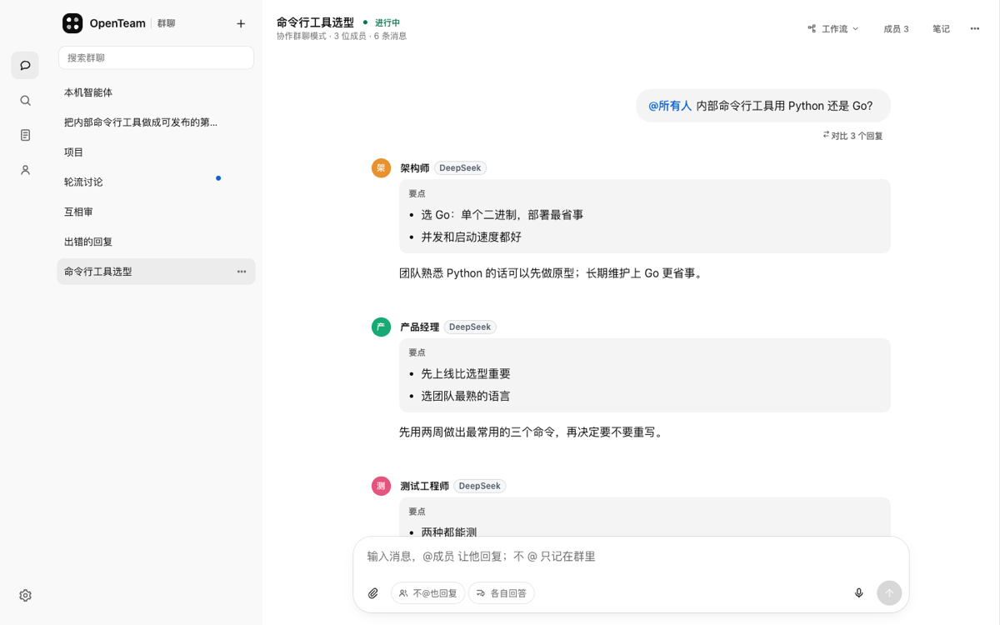
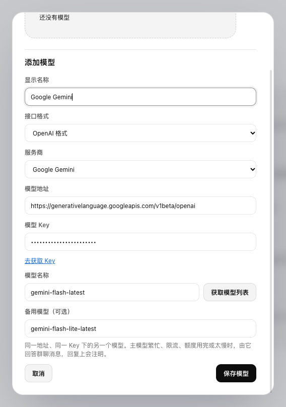
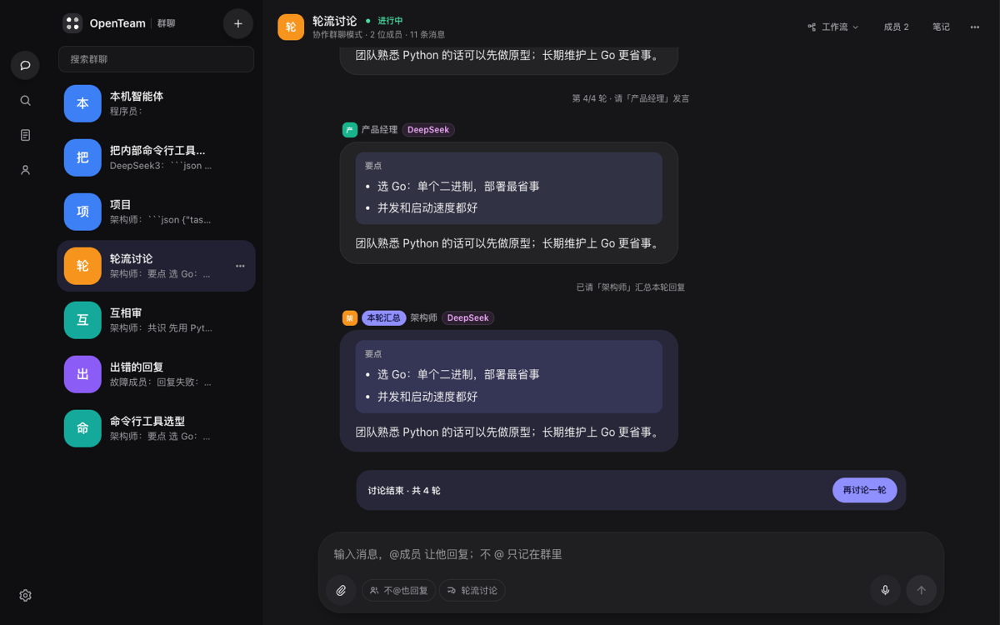
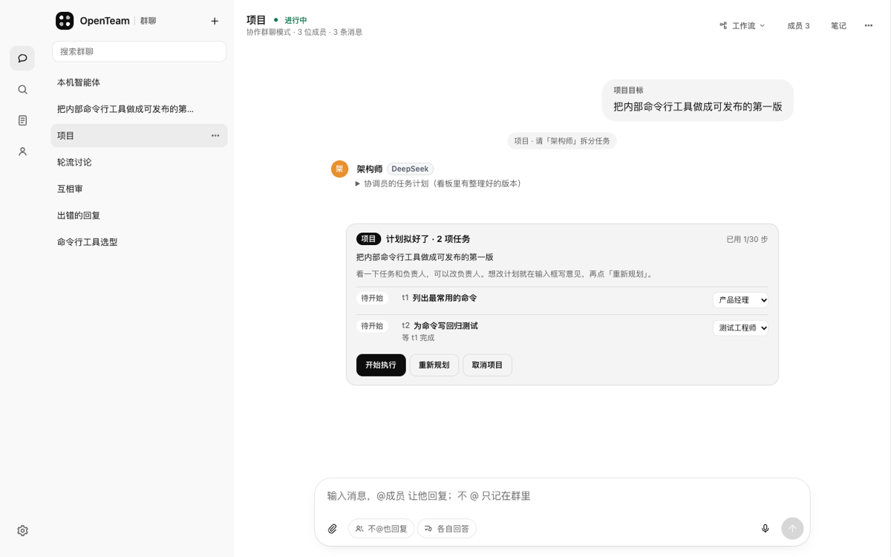
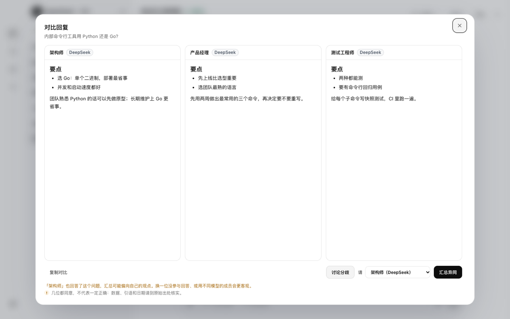
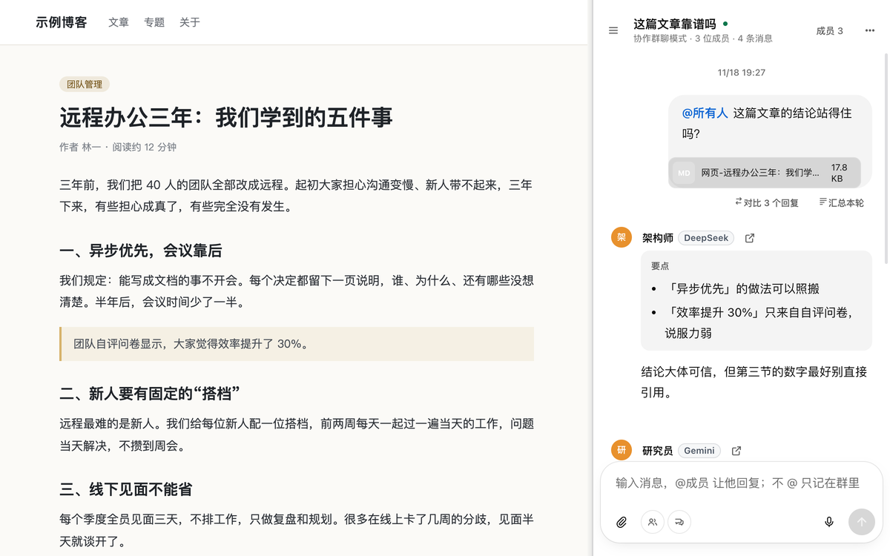
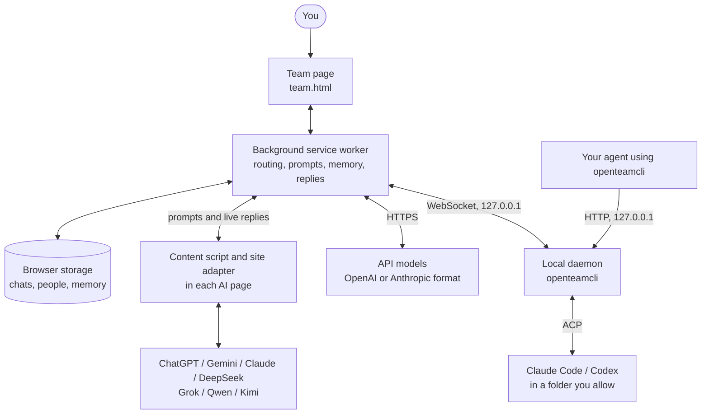
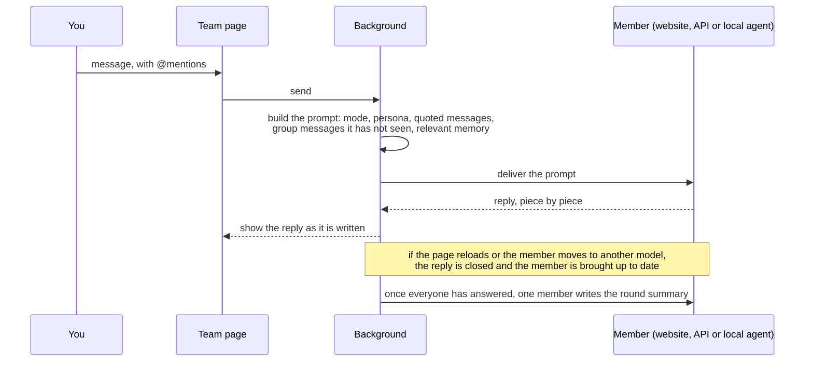
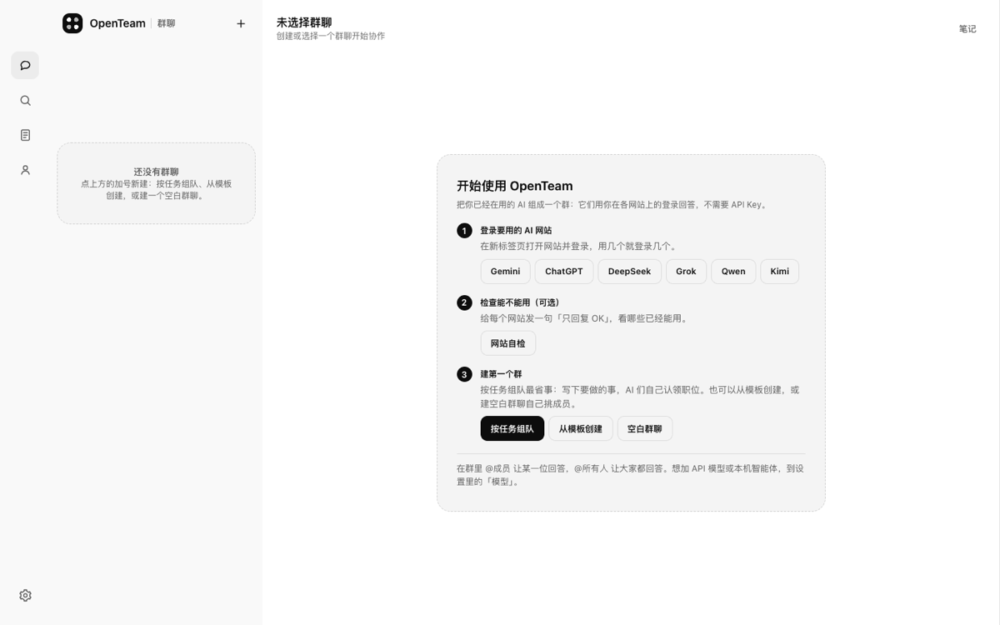

# OpenTeam

**Language:** English | [简体中文](README.zh-CN.md)

> **Origin.** This project is based on **OpenTeam** by **[afumu](https://github.com/afumu)** (original repository: [afumu/openteam](https://github.com/afumu/openteam)). The original code, design and documentation belong to afumu and the OpenTeam contributors and remain under the [PolyForm Noncommercial License 1.0.0](LICENSE) (`Required Notice: Copyright (c) 2026 OpenTeam contributors.`).

> A local-first AI team workspace: put ChatGPT, Gemini, Claude, DeepSeek, Grok, Qwen, Kimi, API models and local coding agents in one group chat, and let them discuss, review each other and work through a project together.

OpenTeam is a Manifest V3 Chrome extension. Most members need no API key: OpenTeam reuses the AI websites you are already signed in to, sends each member its task inside that site, and gathers the replies in one shared chat. When you want them, API models and local agents such as Claude Code or Codex can join the same group.

Use it for learning, research and personal non-commercial work where one answer is not enough: comparing models, fact-checking, design and code reviews, content planning, decisions, and multi-step work that benefits from several roles.



## Highlights

**A team made of the AIs you already use**

- **No API tokens needed**: web members use your existing AI website sessions.
- **Seven AI websites**: Gemini, ChatGPT, Claude, DeepSeek, Grok, Qwen and Kimi as group members, each in its own page; a member can be moved to another site or model at any time.
- **API members**: add any OpenAI- or Anthropic-compatible model. Presets fill in the address for DeepSeek, Gemini, OpenAI, Claude, Qwen, Zhipu, Kimi, Doubao, OpenRouter and SiliconFlow, and the model list is fetched from the provider. A backup model answers when the main one is busy, rate-limited or out of quota. Each reply shows the tokens it used, and a failed request shows the server's own reason.
- **Local agents as members**: Claude Code, Codex or another ACP agent works in a folder you allow, through the local daemon. Every run, file edit and command waits for your approval, and agents that share a folder take turns.
- **Team up for a task**: describe the task, pick the AIs, and each chooses its position; you confirm the roles before work starts.
- **Advisor library**: 38 expert and thinking-style templates, or people you create yourself.

<p></p>

**Ways to work together**

- **Mentions**: `@person` asks one member, `@everyone` asks the whole team.
- **Independent and collaborative modes**: compare separate answers first, then let members read, challenge and build on each other.
- **Turn-by-turn discussion**: members speak one at a time and can hand the turn to someone else; no single member can take over the discussion.
- **Project mode**: a coordinator breaks a goal into tasks with owners and "done" criteria. After you approve, members work in order or in parallel, the coordinator checks each result and asks for rework (with a limit, so tasks are not passed around forever), and finally writes the deliverable on a task board in the chat.
- **Key points and round summaries**: replies to a group start with their key points; once everyone has answered, one member summarises agreements, disagreements, open questions and next steps. You can adopt a summary as a decision with one click.

<table>
  <tr>
    <td width="50%"></td>
    <td width="50%"></td>
  </tr>
  <tr>
    <td>Turn-by-turn discussion with a round summary (Grok-like look, dark)</td>
    <td>Project mode: the plan waits for your approval</td>
  </tr>
</table>

**Memory that lasts across chats**

- **Memory store**: save a fact, decision, preference or note from any message, for every group, one group or one member. Each member gets the pinned items and the ones relevant to the current request, within its context budget; a web member is sent only what it has not seen yet.
- **Kept apart where it should be**: in independent mode a member does not read what other members wrote. Members can also propose items for you to accept or dismiss (off by default).

**Workspace**

- **Live replies**: a web member's reply appears while the site is still writing it; stopping keeps what was written. If a member's page reloads or the member moves to another model mid-reply, the reply is closed properly and the member is brought back up to date.
- **Side panel**: click the OpenTeam icon and the group opens in Chrome's side panel, so you can chat beside the page you are reading. Members' AI pages are kept in the side panel too, so they keep replying while you are in other tabs (an AI page left in a background tab is slowed by Chrome after a few minutes, and its reply stalls). Search, notes, the people library, settings and **Open in a tab** are at the bottom of the ☰ group list. On an older Chrome without a side panel, OpenTeam opens in a tab instead.
- **Attach the page**: on any web page, click the OpenTeam icon or right-click and choose **Send this page to OpenTeam**, and that page appears above the message box. Click **Attach** and the page's text (with any text you selected) goes with your message as a Markdown file, up to 30,000 characters. Until you click **Attach**, OpenTeam does not read the page. To compare several pages, click the globe button **Attach web pages** next to the message box and tick pages open in this window (up to 5); they go as one file, a section per page, within 60,000 characters. The first time a site is read the browser asks whether OpenTeam may visit it, and sites allowed once are not asked about again; OpenTeam never asks for access to every site. Attached text files, the pages file included, open in OpenTeam from the tray before sending and from the message after, with a Download button there; before sending, **Edit** changes the text (to cut what a page does not need, say), and what is saved is what goes out.
- **Images and files**: attach images, PDF, Word, PowerPoint, Excel and text files; images that ChatGPT, Gemini, Grok or Qwen draw are copied into the chat.
- **Compare replies**: put every answer to one question side by side, then ask a member to summarise where they agree and differ.
- **Clickable choices**: when a reply ends with options (A / B / C), answer with one click.
- **Site check**: one click asks every AI site to reply OK and lists, per site, whether it works, wants a sign-in, is blocked, or got the question but gave no reply (what a site's redesign breaks).
- **Backup model for web members**: when a web member's page shows a pop-up, is signed out or reports a site error, an API model you chose for it answers instead; the reply is still its own, marked Backup, and the round goes on. The backup is sent the member's persona and the group's conversation, its earlier answers included, so it can pick up where the member was; once the site works again, the member's page is told what the backup said for it. A member without a backup is not given summaries or discussion turns meanwhile.
- **Scheduled tasks**: in a group's menu, pick the days of the week and a time; at that time the group sends itself a message, and whoever it @mentions answers, for example several models each summing up the news every weekday morning. When it asks web members, OpenTeam opens and becomes the shown tab of its window (web members answer only from a page that is shown), without bringing Chrome in front of other apps; a time missed while the browser was closed is sent once if it comes back within 12 hours. A task can also **send its result** to a Feishu, WeCom or DingTalk group robot (signed, if the robot asks for it), a Slack or Discord channel's webhook, a Telegram group or channel through your bot, or any https webhook (as JSON): once every member has answered, the round's summary goes out when the group sums rounds up, otherwise every member's answer, shortened to what the destination takes. Destinations are added and tested in the scheduled tasks window; an address or bot token is a key, so backups leave it out unless keys are exported.
- **Site usage and limits**: each web member's card shows how many messages its site took today, all members on that site together. When a site says it is limiting (a usage cap, too many requests), OpenTeam stops sending to it for 3 hours: a member with a backup model has the backup answer, one without is skipped with a note in the chat, and summaries and discussion turns go to others. The next day the card warns as the count nears the one the site was limited at. Click **Recovered** on the card to use the site again sooner.
- **Votes**: click Vote next to the message box, write a question and 2–6 options, and pick who votes. Each member picks one option with a reason, without seeing the others' votes; then the group shows a card with the count, who voted for what and why, and one member sums up where they differ. Click **Vote again** to have everyone vote once more having read each other's reasons; the card marks who changed.
- **Sources and fact checks**: switch on Sources next to the message box before sending, and members number the source of each fact [1][2] and list the links, marking what has none [no source]. Each answer lists its sources, and OpenTeam opens them: a link whose site does not respond (often a made-up one) shows in red, with no extra permission. **Check links closely** asks the browser for just those sites, and then also finds missing pages and page titles. Once everyone has answered, a member who sat the round out, on another model if possible, checks the claims one by one; the result is a card of Verified / Doubtful / Wrong / Unverifiable with a conclusion.
- **Usage**: the Usage window in the left rail counts, for today, the last 7 or 30 days or all time, and for all groups or one, how often each member answered and how many input and output tokens the API models used, and estimates the cost from the price per million tokens (yuan or dollars) you enter for each model under Settings → Models, or that **Look up price** finds by the model's name in OpenRouter's public price list (in dollars, no key sent; for a name such as gemini-flash-latest you pick the model it stands for); models without one count tokens only. It also shows answers per day, totals per group, and web members' answers per site with the count each site was last limited at. For DeepSeek and Kimi API accounts it also shows the real balance and actual spend: as dsh-whale-widget does, OpenTeam reads the account balance with the model's own key every hour and when the window opens, counting each drop as that day's spend and top-ups as none; this is the whole account's spend, use outside OpenTeam included.
- **Spending caps**: give an API model a daily cap under Settings → Models, in the currency of its price. Every call's estimated cost is added up (replies, summaries, project tasks, team formation, backing up a web member), and a desktop notification tells you at 80% and at the cap. At the cap the model is not called again until midnight: its reply says why, it is passed over for summaries and discussion turns, and **Keep using today**, under the reply or in the Usage window, lifts the cap for the rest of the day.
- **Tools**: search, edit and resend, voice input, pinned groups, notes, a notification when everyone has answered, a live health status for each AI page, and full backup and restore.
- **Two looks**: a ChatGPT-like and a Grok-like interface, each in light and dark.
- **Local-first**: chats, people, memory, notes and settings stay in your browser.
- **Update notice**: a dot on the settings button when a new release is out, with a link to it.
- **Agent control CLI**: `openteamcli` lets a local agent create groups, add members, post tasks, wait for replies and search or add memory.





## How It Works



Each web member is bound to an AI website page inside the OpenTeam workspace. When you send a message, OpenTeam builds a prompt from the chat mode, the member's persona, quoted messages, shared context and relevant memory, delivers it into the member's page, and follows the reply as it is written.



API members are called directly from the extension; local agents run through the local daemon.

| Site | Common fit |
| --- | --- |
| Gemini | Long context, research, multimodal material |
| ChatGPT | General execution, fast iteration |
| Claude | Long documents, review, structured writing, careful reasoning |
| DeepSeek | Code, reasoning, Chinese-language work |
| Grok | Current events, alternative phrasing |
| Qwen | Chinese and multilingual writing, code, long documents (chat.qwen.ai) |
| Kimi | Long documents, Chinese-language research and writing (www.kimi.com) |

These are practical defaults, not rankings. Quality depends on model versions, account plans, task type and input.

## Disclaimer

OpenTeam is an unofficial project for learning, research and personal non-commercial use only. It is not affiliated with, endorsed by or supported by OpenAI, Anthropic, Google, DeepSeek, xAI, Alibaba, Moonshot AI or any supported AI website.

OpenTeam works with AI websites through your own signed-in browser sessions and page automation. Website changes, account rules, rate limits, anti-abuse systems or terms of service may affect whether it works. You are responsible for following the rules, policies and laws that apply to your use.

Do not use OpenTeam for commercial products, hosted services, paid workflows, bulk automation, spam, scraping, bypassing access controls or paid access, or anything that violates third-party terms or rights.

Use it at your own risk. The maintainers are not responsible for account restrictions, service interruptions, data loss, legal issues or other consequences of your use. This notice is not legal advice.

## Install

### Download a release

1. Download `openteam-extension-v<version>.zip` from the [latest release](https://github.com/Lushangtu123/openteam/releases/latest) and unzip it into a folder you will keep (Chrome loads the extension from that folder).
2. Open `chrome://extensions/`, turn on Developer mode, click **Load unpacked** and choose the folder.
3. Click the OpenTeam icon; it opens in the side panel (for a full page, use **Open in a tab** in the ☰ group list). The first screen walks you through signing in to the AI websites, checking they work, and making a first group.



OpenTeam says in its settings when a new version is out, with a dot on the settings button. To update, empty that folder, unzip the new version into it and click the reload button on OpenTeam in `chrome://extensions/`. Your chats are kept in the browser, so an update keeps them; removing OpenTeam from Chrome deletes them (make a backup in settings first).

### Build from source

```bash
git clone https://github.com/Lushangtu123/openteam.git
cd openteam
npm install
npm run build
```

Then load the generated `dist/` folder as in step 2 above.

After pulling changes, run `npm run build` again and click the reload button on OpenTeam in `chrome://extensions/`.

### Local agents and the CLI (optional)

Needed only for local agent members or to let an agent such as Codex or Claude Code control OpenTeam. Install the CLI from the latest release (`npm install -g https://github.com/Lushangtu123/openteam/releases/latest/download/openteamcli.tgz`, then `openteamcli daemon start`), or run it from the repository folder:

```bash
npm run openteamcli -- daemon start
npm run openteamcli -- doctor
```

Then enable local agent control in OpenTeam's settings. To give your agent the OpenTeam control skill, install it from the repository folder:

```bash
npx skills add . --skill openteam-control
```

From anywhere else, `npx skills add Lushangtu123/openteam --skill openteam-control` installs it from GitHub.

The daemon does not start by itself after a restart. On macOS, `npm run openteamcli -- daemon install` adds it as a LaunchAgent that starts at login; `daemon uninstall` removes it. An agent can also run on another machine (DeepSeek Harness in a VM, say, started over SSH): see Remote agents there. See [OpenTeam CLI](packages/openteamcli/README.md) for all commands.

## Development

```bash
npm install
npm run dev       # watch build into dist/
npm run verify    # type check, unit tests and production build
npm run package   # after a build: release/ gets the extension ZIP, the CLI tarball and checksums
```

To publish a release, set the same version in `package.json` and `public/manifest.json`, commit, and push a tag `v<version>`. The release workflow checks the versions, runs the checks and attaches the files to a GitHub release.

`npm run visual:snap -- <folder>` and `npm run visual:compare -- <before> <after>` take screenshots of every screen (both looks, both themes, three widths) and compare two sets, with an accessibility check on each screen.

## Permissions and Privacy

- `storage` / `unlimitedStorage`: chats, people, memory, notes, settings and large chats.
- `tabs`: find and talk to OpenTeam and AI-site tabs and frames.
- `alarms`: runtime maintenance.
- `declarativeNetRequest`: adjust response headers so supported AI websites can open inside the workspace.
- `clipboardRead` / `clipboardWrite`: copy and paste.
- `cookies`: Grok's session cookies, so its live connection works inside the workspace (OpenTeam's own tabs only).
- `notifications`: tell you when everyone has answered (can be turned off).
- `sidePanel`: open OpenTeam in Chrome's side panel.
- `activeTab` / `scripting`: attaching a page. Clicking the OpenTeam icon or the right-click menu lets OpenTeam read that one page; it reads it only when you click **Attach**, and loses access once you move to another page. Attaching several open pages asks for each site's access once, through the browser's own prompt.
- `contextMenus`: **Send this page to OpenTeam** in a page's right-click menu.
- Host permissions: only the supported AI websites, their image hosts and the local daemon. Each API model address is allowed separately, when you click **Allow access** on that model.
- Microphone (no manifest permission): voice input uses Chrome's online speech recognition; Chrome asks the first time.

Attached images are stored in the browser (IndexedDB) and uploaded only when you send them. API keys stay in browser storage and are left out of backups unless you include them. Once a day OpenTeam asks GitHub for the latest release's version number, to tell you about updates; nothing is sent but that request, and you can turn it off under Settings > General. There is no cloud sync; your conversations are processed by the AI websites and model providers you use, under their own terms.

## Current Limits

- Chrome / Chromium only.
- AI-site adapters depend on each site's page structure, so a redesign can break sending or reading replies.
- Embedding sites needs response-header changes through `declarativeNetRequest`, a heavier permission than a normal extension.
- A site can refuse to run inside other pages. OpenTeam shows this on the member's status and does not work around it; such a model can still join as an API member.
- Signed-out sessions have limits: signed-out Gemini does not send images, and signed-out Grok asks you to sign in before drawing.
- When the side panel opens while members are writing replies, the OpenTeam tab finishes those replies before handing over, waiting 3 minutes at most. Closing the side panel or refreshing the OpenTeam page reloads members' AI pages, and the new page goes on reading the reply from the site; if the site stopped writing when the page closed, only what had been read is kept, and **Resync full reply** reads it again.
- Chrome lets no extension read `chrome://` pages, other extensions' pages or the Chrome Web Store, so those pages cannot be attached.
- Voice input needs a network connection.
- Famous-person advisor templates are prompts inspired by public ideas, not real people.
- Medical, legal, financial and other high-stakes answers still need human judgment and qualified advice.

## Repository Layout

```text
public/                 extension manifest, team page, styles, DNR rules
src/background/         service worker, message and command handlers, model clients
src/content/            AI-site content scripts and adapters
src/group/              group data model, store, roles, prompts, memory, mentions
src/teamPage/           OpenTeam workspace UI
packages/openteamcli/   local CLI and daemon for agents
docs/                   design documents
```

## Documentation

- [Design document](docs/DESIGN.md)
- [Team formation](docs/TEAM_FORMATION.md)
- [Project mode](docs/PROJECT_MODE.md)
- [Memory store](docs/MEMORY_STORE.md)
- [AI page health status](docs/AI_PAGE_HEALTH.md)
- [Images and attachments](docs/MULTIMODAL_ATTACHMENTS.md)
- [Local agents (ACP)](docs/ACP.md)
- [OpenTeam CLI](packages/openteamcli/README.md)
- [Contributing](CONTRIBUTING.md)

Issues and pull requests are welcome at [Lushangtu123/openteam](https://github.com/Lushangtu123/openteam). Run `npm run verify` before opening a pull request.

## License

Released under the [PolyForm Noncommercial License 1.0.0](LICENSE) (SPDX `PolyForm-Noncommercial-1.0.0`). You may use, study, modify and redistribute it for non-commercial purposes only; commercial use, commercial redistribution, hosted commercial services and paid workflows are not permitted without separate written permission.

Reading PDFs uses Mozilla's [pdf.js](https://github.com/mozilla/pdf.js) (`pdfjs-dist`), under the Apache License 2.0; the build includes its license at `pdfjs/LICENSE`.
