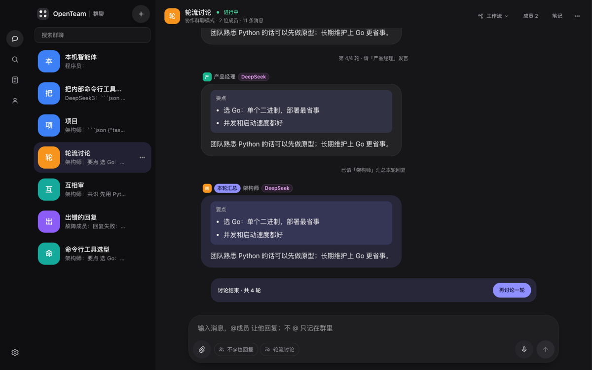
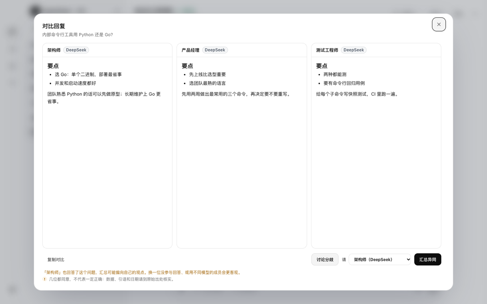
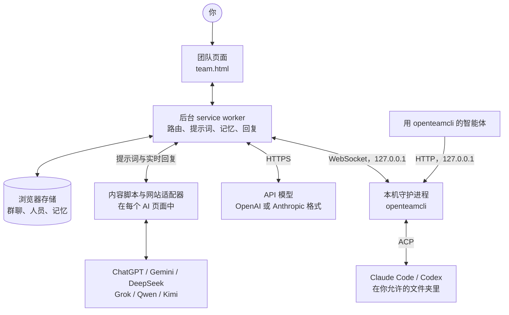
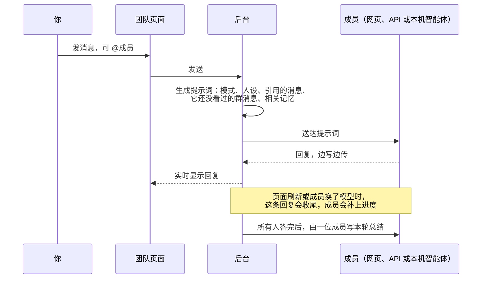

# OpenTeam

**语言：** [English](README.md) | 简体中文

> **项目来源：** 本项目基于 **[afumu](https://github.com/afumu)** 的 **OpenTeam**（原仓库：[afumu/openteam](https://github.com/afumu/openteam)）修改而来。原始代码、设计与文档归 afumu 及 OpenTeam 贡献者所有，并继续遵循 [PolyForm Noncommercial License 1.0.0](LICENSE)（`Required Notice: Copyright (c) 2026 OpenTeam contributors.`）。

> 本地优先的 AI 团队工作台：把 ChatGPT、Gemini、DeepSeek、Grok、Qwen、Kimi、API 模型和本机编程智能体放进同一个群聊，让它们讨论、互相审查，一起推进项目。

OpenTeam 是一个 Manifest V3 Chrome 扩展。大多数成员不需要 API Key：OpenTeam 复用你已经登录的 AI 网页，在各自的网站里把任务发给成员，再把回复汇总到同一个群聊。需要时，API 模型和 Claude Code、Codex 等本机智能体也可以加入同一个群。

适合学习、研究和个人非商用场景里"一个答案不够"的问题：多模型对比、事实核查、方案和代码评审、内容策划、个人决策，以及需要多个角色配合完成的连续任务。


## 核心亮点

**用你已有的 AI 组成团队**

- **不需要 API token**：网页成员使用你已登录的 AI 网站账号。
- **六个 AI 网站**：Gemini、ChatGPT、DeepSeek、Grok、Qwen、Kimi 都能作为群成员，各占一个页面；成员随时可以换到别的网站或模型。
- **API 成员**：可添加任何 OpenAI 或 Anthropic 兼容的模型（DeepSeek、Gemini、智谱、火山方舟、OpenRouter 等）。每条回复显示用了多少 token，请求失败时显示服务器给出的原因。
- **本机智能体当成员**：Claude Code、Codex 或其他 ACP 智能体通过本机守护进程，在你允许的文件夹里工作。每次运行、每次改文件和执行命令都要你批准；共用同一文件夹的智能体会排队，不会同时动手。
- **按任务组队**：描述任务、挑选 AI，由它们各自认领岗位，你确认后再开工。
- **顾问库**：内置 38 个专家和思维方式模板，也可以自己创建人员。

**协作方式**

- **@ 提及**：`@成员` 只问一个人，`@所有人` 问全队。
- **独立与协作模式**：先各自独立回答做对比，再让成员互相引用、质疑和补充。
- **轮流讨论**：成员依次发言，可以把下一轮交给别人；不会有某个成员一直霸占发言。
- **项目模式**：协调人把目标拆成有负责人和完成标准的任务。你批准后，成员按顺序或并行执行，协调人逐项验收、要求返工（有次数上限，任务不会被无限踢来踢去），最后在群聊的任务看板上写出完整交付物。
- **要点与轮次总结**：发给多人的回复先列要点；所有人答完后，由一位成员总结共识、分歧、待核实之处和下一步。总结可以一键采纳为决定。

<table>
  <tr>
    <td width="50%"></td>
    <td width="50%"></td>
  </tr>
  <tr>
    <td>轮流讨论与本轮总结（类 Grok 界面，深色）</td>
    <td>项目模式：计划等你批准后开始</td>
  </tr>
</table>

**跨群聊的记忆库**

- **记忆库**：从任意消息保存事实、决定、偏好或备注，可用于所有群、某个群或某位成员。每位成员会收到置顶条目和与当前请求相关的条目，不超出它的上下文预算；网页成员只会收到它还没见过的内容。
- **该隔离的地方隔离**：独立模式下，成员读不到其他成员写的内容。成员也可以提议保存条目，由你接受或忽略（默认关闭）。

**工作台**

- **实时回复**：网页成员的回复边写边显示，停止时保留已写的内容。成员页面中途刷新或换了模型，这条回复会正常收尾，成员也会重新跟上群里的进度。
- **图片与文件**：可附加图片、PDF、Word、PowerPoint、Excel 和文本文件；ChatGPT、Gemini、Grok、Qwen 画出的图片会复制到群聊。
- **对比回复**：把同一问题的所有回答并排显示，再请一位成员总结异同。
- **一键作答**：回复以选项（A / B / C）结尾时，点一下就能回答。
- **工具**：搜索、编辑后重发、语音输入、置顶群聊、笔记、所有人答完时的通知、每个 AI 页面的健康状态，以及全量备份与恢复。
- **两种界面**：类 ChatGPT 和类 Grok 两种风格，各有浅色和深色。
- **本地优先**：群聊、人员、记忆、笔记和设置都保存在你的浏览器里。
- **智能体控制 CLI**：`openteamcli` 让本机智能体创建群聊、添加成员、发布任务、等待回复，以及查询和保存记忆。



## 工作原理



每位网页成员绑定 OpenTeam 工作台里的一个 AI 网站页面。你发消息时，OpenTeam 根据群聊模式、成员人设、引用的消息、共享上下文和相关记忆生成提示词，送进成员的页面，并在回复写出的过程中实时读取。



API 成员由扩展直接调用；本机智能体通过本机守护进程运行。

| 网站 | 常见适用场景 |
| --- | --- |
| Gemini | 长上下文、调研、多模态材料 |
| ChatGPT | 通用执行、快速迭代 |
| DeepSeek | 代码、推理、中文任务 |
| Grok | 时事、换一种说法 |
| Qwen | 中文与多语言写作、代码、长文档（chat.qwen.ai） |
| Kimi | 长文档、中文调研与写作（www.kimi.com） |
| Claude | claude.ai 拒绝在其他页面里运行，请以 API 成员（Anthropic 格式）添加 |

以上只是常用默认选择，不是排名。实际效果取决于模型版本、账号套餐、任务类型和输入材料。

## 免责声明

OpenTeam 是非官方项目，仅供学习、研究和个人非商业使用。它与 OpenAI、Anthropic、Google、DeepSeek、xAI、阿里巴巴、月之暗面或任何受支持的 AI 网站均无关联，也未获得其认可或支持。

OpenTeam 通过你自己登录的浏览器会话和页面自动化与 AI 网站交互。网站改版、账号规则、频率限制、反滥用机制或服务条款都可能影响它能否正常工作。你需要自行遵守适用于你的使用场景的规则、政策和法律。

不得将 OpenTeam 用于商业产品、托管服务、付费工作流、批量自动化、垃圾信息、爬取数据、绕过访问控制或付费限制，或任何侵犯第三方条款与权利的行为。

使用风险自负。对于因使用本项目导致的账号限制、服务中断、数据丢失、法律问题或其他后果，维护者不承担责任。本声明不构成法律意见。

## 安装

### 下载发布包

1. 从 [最新发布](https://github.com/Lushangtu123/openteam/releases/latest) 下载 `openteam-extension-v<版本>.zip`，解压到一个会长期保留的文件夹（Chrome 从这个文件夹加载扩展）。
2. 打开 `chrome://extensions/`，开启开发者模式，点击「加载已解压的扩展程序」，选择该文件夹。
3. 先在普通标签页登录要用的 AI 网站，再点击 OpenTeam 图标。

更新时，清空这个文件夹，把新版本解压进去，再在 `chrome://extensions/` 里点 OpenTeam 的重新加载按钮。群聊数据保存在浏览器里，更新不会丢失；但在 Chrome 里移除 OpenTeam 会删除它们（移除前先在设置里备份）。

### 从源码构建

```bash
git clone https://github.com/Lushangtu123/openteam.git
cd openteam
npm install
npm run build
```

然后按上面第 2 步加载生成的 `dist/` 文件夹。

拉取更新后，重新运行 `npm run build`，再在 `chrome://extensions/` 里点 OpenTeam 的重新加载按钮。

### 本机智能体与 CLI（可选）

只有使用本机智能体成员，或想让 Codex、Claude Code 等智能体控制 OpenTeam 时才需要。可以安装发布包里的 CLI（`npm install -g ./afumu-openteamcli-<版本>.tgz`，再运行 `openteamcli daemon start`），也可以在仓库文件夹里运行：

```bash
npm run openteamcli -- daemon start
npm run openteamcli -- doctor
```

然后在 OpenTeam 设置里打开本机智能体控制。要给你的智能体安装 OpenTeam 控制技能，在仓库文件夹里运行：

```bash
npx skills add . --skill openteam-control
```

电脑重启后守护进程不会自动启动。在 macOS 上，`npm run openteamcli -- daemon install` 会把它添加为登录时启动的 LaunchAgent；`daemon uninstall` 可移除。全部命令见 [OpenTeam CLI](packages/openteamcli/README.zh-CN.md)。

## 开发

```bash
npm install
npm run dev       # 监听构建到 dist/
npm run verify    # 类型检查、单元测试和生产构建
npm run package   # 构建后运行：在 release/ 里生成扩展 zip、CLI 包和校验和
```

发布新版本时，把 `package.json` 和 `public/manifest.json` 的版本号改成一样，提交后推送标签 `v<版本>`。发布流程会核对版本号、跑完检查，并把文件附到 GitHub Release 上。

`npm run visual:snap -- <文件夹>` 和 `npm run visual:compare -- <之前> <之后>` 会给每个界面截图（两种界面、两种主题、三种宽度）并逐像素比较两组截图，同时对每个界面做无障碍检查。

## 权限与隐私

- `storage` / `unlimitedStorage`：保存群聊、人员、记忆、笔记、设置和大量聊天记录。
- `tabs`：找到 OpenTeam 和 AI 网站的标签页与页面框架并与之通信。
- `alarms`：运行时维护任务。
- `declarativeNetRequest`：调整响应头，让受支持的 AI 网站能在工作台里打开。
- `clipboardRead` / `clipboardWrite`：复制和粘贴。
- `cookies`：读取 Grok 的会话 Cookie，让它的实时连接在工作台里可用（只作用于 OpenTeam 自己的标签页）。
- `notifications`：所有人答完时提醒你（可在设置里关闭）。
- 网站权限：只包括受支持的 AI 网站、它们的图片域名和本机守护进程。每个 API 模型的地址单独授权，在该模型上点「允许访问」即可。
- 麦克风（不在 manifest 中申请）：语音输入使用 Chrome 的在线语音识别，首次使用时由 Chrome 询问。

附加的图片保存在浏览器（IndexedDB）里，只在发送时上传。API Key 保存在浏览器存储中，备份默认不包含它。OpenTeam 不提供云同步；你的对话由你使用的 AI 网站和模型服务商按其自身条款处理。

## 当前限制

- 仅支持 Chrome / Chromium。
- AI 网站适配依赖各网站的页面结构，网站改版可能导致发送或读取回复失败。
- 在工作台里嵌入网站需要通过 `declarativeNetRequest` 修改响应头，权限比普通扩展更重。
- 有些网站有意拒绝在其他页面里运行（目前是 claude.ai）。OpenTeam 会在成员状态上说明，不会绕过。
- 未登录的会话有限制：未登录的 Gemini 不能发送图片，未登录的 Grok 画图前会要求登录。
- 语音输入需要联网。
- 名人顾问模板是受公开思想启发的提示词，不是真人。
- 医疗、法律、金融等高风险问题的回答仍需要人工判断和专业意见。

## 仓库结构

```text
public/                 扩展 manifest、团队页面、样式、DNR 规则
src/background/         service worker、消息与命令处理、模型客户端
src/content/            AI 网站内容脚本与适配器
src/group/              群聊数据模型、存储、角色、提示词、记忆、提及解析
src/teamPage/           OpenTeam 工作台界面
packages/openteamcli/   供智能体使用的本机 CLI 与守护进程
docs/                   设计文档
```

## 文档

- [设计文档](docs/DESIGN.zh-CN.md)
- [按任务组队](docs/TEAM_FORMATION.md)
- [项目模式](docs/PROJECT_MODE.md)
- [记忆库](docs/MEMORY_STORE.zh-CN.md)
- [AI 页面健康状态](docs/AI_PAGE_HEALTH.md)
- [图片与附件](docs/MULTIMODAL_ATTACHMENTS.md)
- [本机智能体（ACP）](docs/ACP.md)
- [OpenTeam CLI](packages/openteamcli/README.zh-CN.md)
- [贡献指南](CONTRIBUTING.md)

欢迎到 [Lushangtu123/openteam](https://github.com/Lushangtu123/openteam) 提交 Issue 和 Pull Request。提交 PR 前请运行 `npm run verify`。

## 许可证

本项目以 [PolyForm Noncommercial License 1.0.0](LICENSE)（SPDX：`PolyForm-Noncommercial-1.0.0`）发布。你可以出于非商业目的使用、学习、修改和再分发；未经另行书面许可，不得用于商业用途、商业再分发、商业托管服务或付费工作流。

读取 PDF 使用 Mozilla 的 [pdf.js](https://github.com/mozilla/pdf.js)（`pdfjs-dist`），遵循 Apache License 2.0；构建产物在 `pdfjs/LICENSE` 中附带其许可证。
